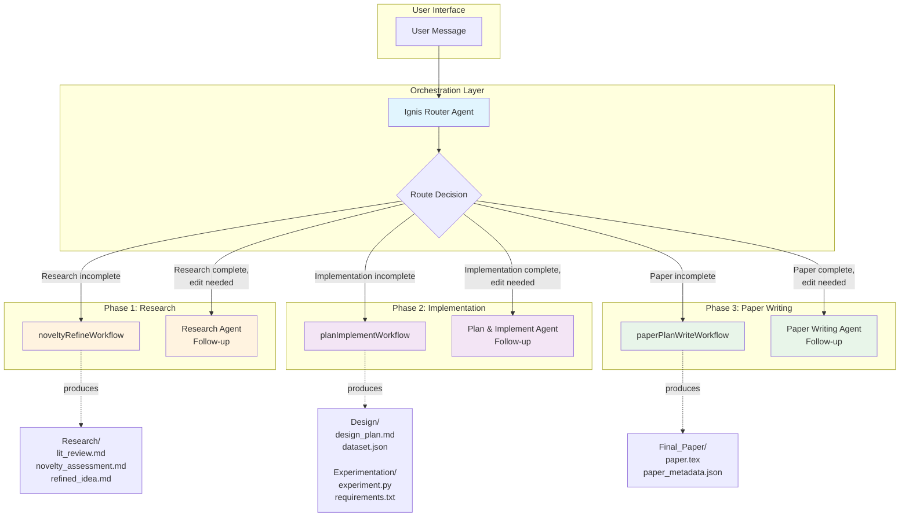
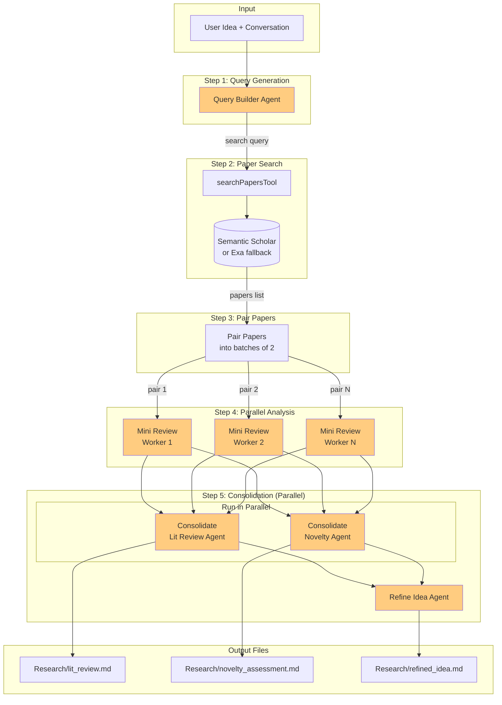
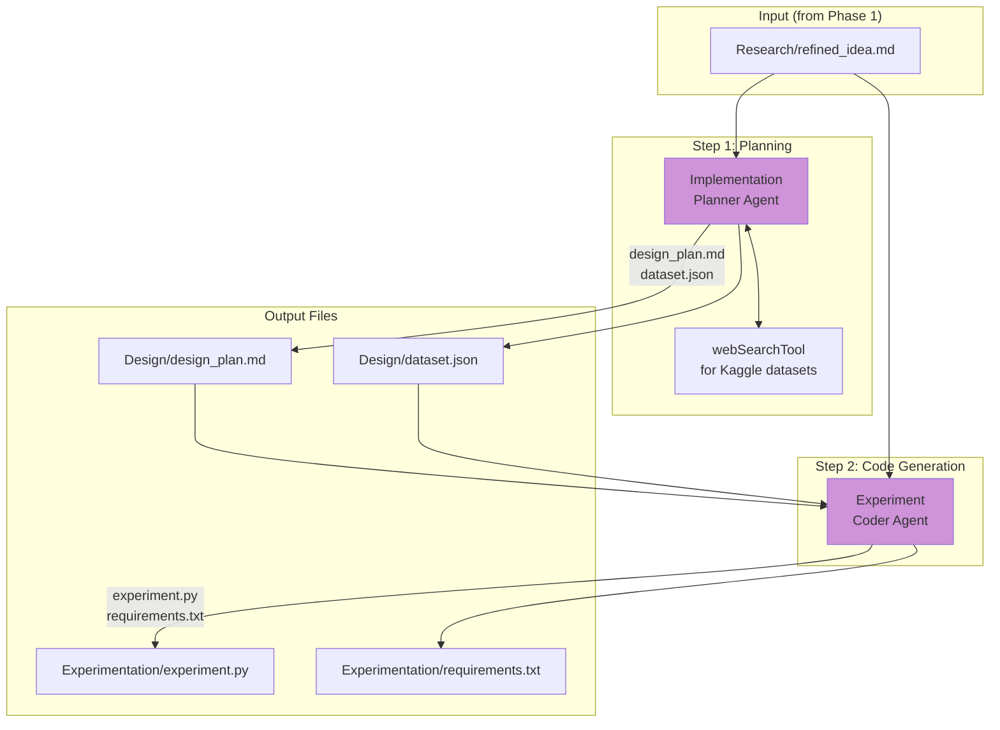
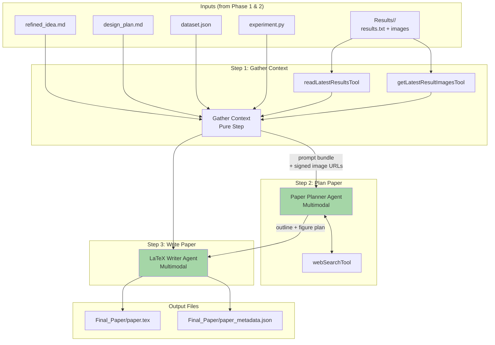
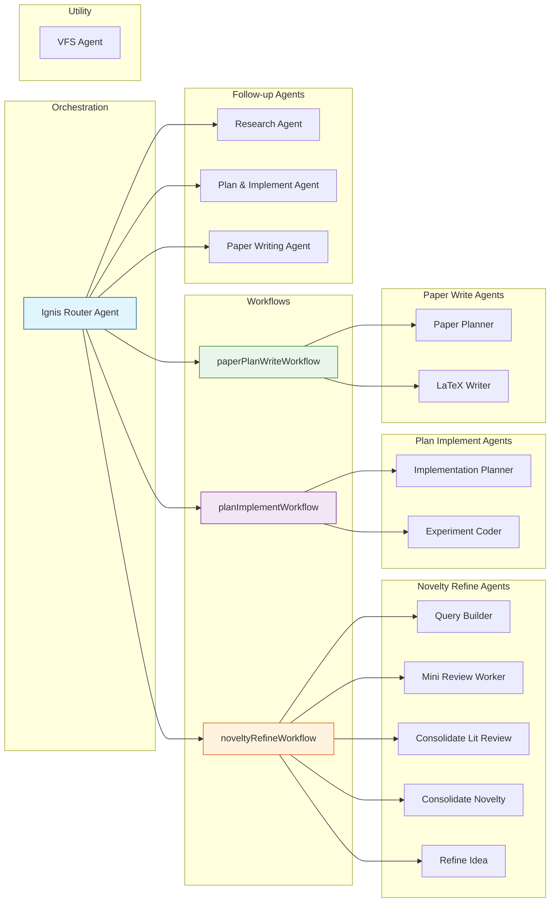
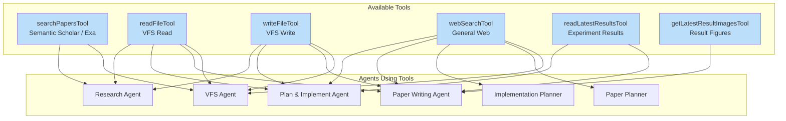
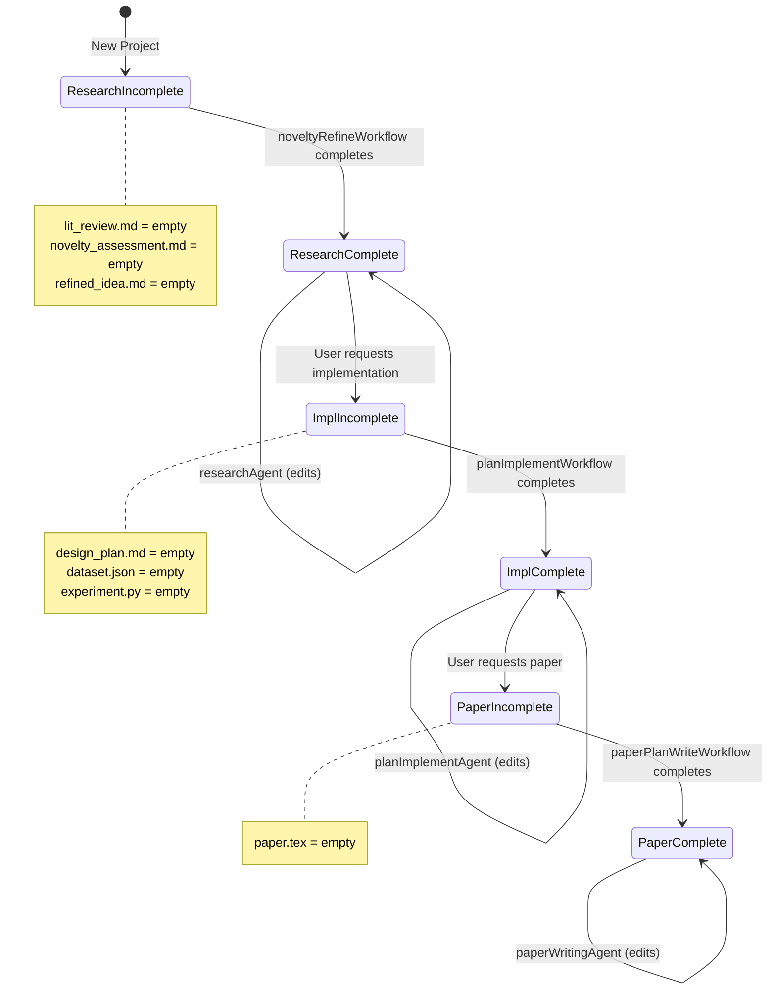

# Ignis Agent Architecture Flowchart

## Main Architecture Overview

---

## Novelty Refine Workflow (Phase 1)

---

## Plan & Implement Workflow (Phase 2)

---

## Paper Plan & Write Workflow (Phase 3)

---

## Complete Agent Hierarchy

---

## Tools & Data Flow

---

## Phase Gates & State Machine

---

## Summary Table

| Agent | Category | Phase | Tools |
|-------|----------|-------|-------|
| **Ignis Router** | Orchestration | All | None (dispatches) |
| **Research Agent** | Follow-up | 1 | read, write, search_papers |
| **Plan & Implement Agent** | Follow-up | 2 | read, write, web_search, latest_results |
| **Paper Writing Agent** | Follow-up | 3 | read, write, web_search, latest_results, images |
| **Query Builder** | Workflow | 1 | None |
| **Mini Review Worker** | Workflow | 1 | None |
| **Consolidate Lit Review** | Workflow | 1 | None |
| **Consolidate Novelty** | Workflow | 1 | None |
| **Refine Idea** | Workflow | 1 | None |
| **Implementation Planner** | Workflow | 2 | web_search |
| **Experiment Coder** | Workflow | 2 | None |
| **Paper Planner** | Workflow | 3 | web_search |
| **LaTeX Writer** | Workflow | 3 | None |
| **VFS Agent** | Utility | - | read, write, web_search, search_papers |
